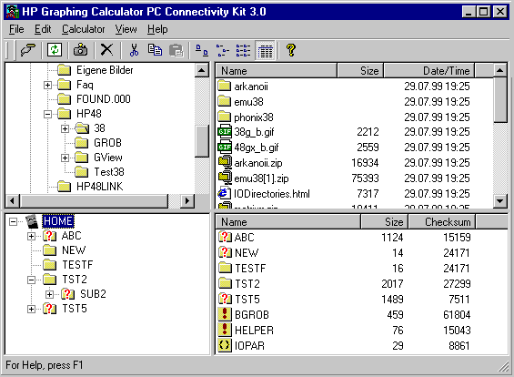
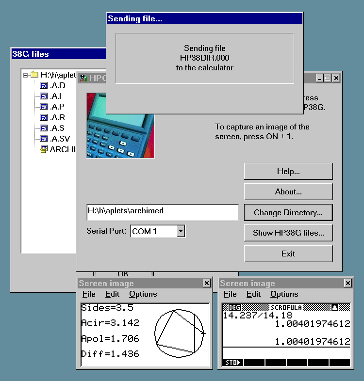
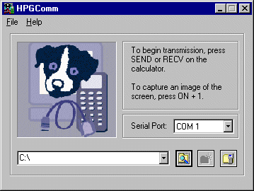
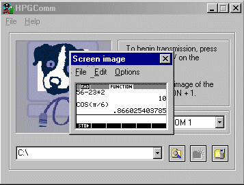
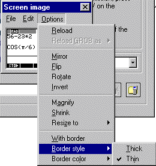
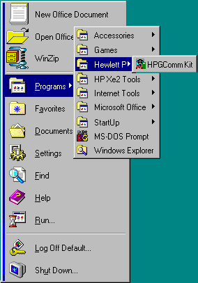

# HPComm — PC connectivity software for HP graphing calculators

HPComm is a family of Windows programs for transferring files between a PC
and Hewlett-Packard graphing calculators over a serial cable. This repository
archives the source code, help files and website of the HPComm project
(1999–2001) by Jean-Pierre "James" Bergamin, with contributions by Mitch Davis
and Colin Croft.

Two programs were produced:

- **HPComm** talks to the HP48 series and the HP49G using the Kermit protocol.
  It presents the calculator's directory tree and the PC file system side by
  side in an Explorer-like window with drag-and-drop.
- **HPComm38**, later renamed **HPGComm**, talks to the HP38G, HP39G and HP40G
  (Kermit, plus XModem for uploading binary aplets to the HP39G/HP40G).

All code is released under the GNU General Public License, version 2.

## History

HPComm began as Jean-Pierre Bergamin's own open-source replacement for HP's
PC link software: an Explorer-like window showing the calculator's directory
tree next to the PC file system, talking Kermit (and XModem) over a serial
cable. HPComm 2.4 was released in February 1999 and is still on
[hpcalc.org](https://www.hpcalc.org/details/3717).

Hewlett-Packard then approached the project. HPComm 3.0 was co-developed by
James Bergamin and Mitch Davis of Hewlett-Packard and shipped by HP in 1999 in
the "purple box" of the official *HP Graphing Calculator PC Connectivity Kit*
(HP part number F1897A: CD-ROM, serial cable and adapter) for the HP48 and the
new HP49G. HP agreed to release it under the GPL; the hpcomm.org FAQ of
November 1999 put it this way:

> One of the biggest challenges I had while co-writing HPComm 3.0 was to get
> HP to make it Open Source. Having done so, I hope this paves the way for
> people to use the source code and make equivalent programs available on
> other platforms.

The release notes of HPComm 3.0r3 (`hpcomm/readme.txt` in the history of this
repository) describe the arrangement:

> Hewlett Packard Graphing Calculator PC Connectivity Kit
> Release Notes         HPComm 3.0r3          23-Mar-2000
>
> Hello and thank you for purchasing or downloading this
> software.  It is the result of a partnership between
> Hewlett Packard and the HPComm Project, and is being
> released simultaneously by both parties.
>
> This is version 3.0r3, which fixes a number of defects in
> version 3.0r2.  Improvements continue to be made, so it
> is very likely that an improved version of this software
> will be available by the time you read this.

The hpcomm.org front page (archived in `website/index.html`) described the
project in mid-2000:

> HPComm and HPComm38 are free programs which allow you to transfer data
> between a PC, and HP graphing calculators. HPComm and HPComm38 were
> developed by James Bergamin and Mitch Davis. HPComm and HPComm38 are also
> distributed by Hewlett Packard, as the official software in the "HP
> Graphing Calculator PC Connectivity Kit".

Timeline, as documented on hpcomm.org, hpcalc.org and SourceForge:

| Date | Release |
| --- | --- |
| Feb 1999 | HPComm 2.4, pre-HP |
| 1999 | HPComm 3.0 in HP's Connectivity Kit |
| 13 Sep 1999 | HPComm 3.0r2 |
| 24 Dec 1999 | HPComm38 1.0 for the HP38G split out of a 3.1 beta |
| 23 Mar 2000 | HPComm 3.0r3 and HPComm38 1.0r3 |
| 2 Jun 2000 | HPComm 3.0r4 and HPComm38 1.0r4, the final releases |
| Jan–Apr 2001 | HPGComm 2.0 betas 1 to 8 (b5 and b6 are on SourceForge) |
| 12 Jun 2001 | HPGComm 2.0; 2.01 on 1 Jul 2001 |
| 14 May 2002 | Project declared finished on hpcomm.sourceforge.net |

HPComm38 was then reworked for the HP39G and HP40G and renamed HPGComm. Its
README (`hpgcomm/README.TXT`) explains:

> HPGComm Version 2.01 (1.07.2001)
>
> It has been a long time since the last major update of HPComm38 and
> since then HP has introduced the HP39G/40G successors to the HP38G. To
> support the new calculators, HPComm38 has now been modified and been
> given a new name: HPGComm.
>
> Major changes to HPComm38
> - Support of HP 39G and 40G calculators added
> - Nicer layout :-)
> - The ability to create directories on the PC from within HPGComm
> - The last six directories used can be recalled for easy re-use
> - File transfers can be cancelled at the PC end
> - Better error handling of directory files
> - Better overall error handling
> - Other bug-fixes
> - XModem support (see below)
>
> Changes in 2.01
> - Fixed a bug where an aplet with many programs/libraries failed to
>   download completely

HPGComm went through eight betas between January and April 2001; version 2.0
was released on 12 June 2001 and 2.01 on 1 July 2001. The last edit to the
HPGComm sources dates from 3 July 2001.

## Repository layout

| Path | Contents |
| --- | --- |
| `hpcomm/` | HPComm 3.0r4 for the HP48 series and HP49G, the final release as published on hpcalc.org, with the WinHelp source in `hlp/` and the original `readme.txt`, `readme-win95.txt` and `copying.txt`. The earlier 3.0r3 working copy (CVS branch `TR3_0_R2_FIX`, with `doc/ProjectPlan.txt` and the issue list) is the previous commit of this directory. |
| `hpcomm38/` | HPComm38 1.0r4 for the HP38G (June 2000), the last release before the HPGComm rework. |
| `hpgcomm/` | HPGComm 2.01 for the HP38G, HP39G and HP40G (project files are still named `HPComm38.*`). Includes the HTML Help source and compiled-help inputs in `help/`, the NSIS installer script `HPGComm.nsi`, `README.TXT`, `Warning.txt` and `license.txt`. |
| `hpgcomm/help-src/` | An earlier, separate copy of the HTML Help source (`HPGComm.hhp`). |
| `hpgcomm/DLLTest/` | A small MFC DLL test project (June 2001). |
| `hpcommshell/` | HPCommShell, an unfinished Windows Explorer namespace extension (June 2001) that was meant to show the calculator as a folder inside Explorer. Reuses the Kermit and protocol classes from HPComm. |
| `website/` | The www.hpcomm.org website as kept in CVS: HTML pages, the FAQ source (`faq.dat`, built by `makefaq`), the mailing-list CGI and the screenshots in `images/`. |
| `docs/screenshots/` | Screenshots from the website and the HPGComm help, as the original GIFs and as PNG conversions. |
| `LICENSE` | GNU General Public License, version 2 (copy of `hpcomm/copying.txt`). |

Compiled binaries, help files (`.HLP`, `.chm`), Visual C++ workspace state
(`.ncb`, `.opt`, `.plg`, `.aps`, `.clw`), help-compiler logs and the `CVS/`
metadata directories were left out of the archive. Line endings are stored
byte-for-byte as they were on disk (`.gitattributes` sets `* -text`); most
files use CRLF.

## Screenshots

HPComm 3.0 (HP48/HP49), from the hpcomm.org website:



HPComm38 1.0 (HP38G) sending a file, with the file tree and two captured
calculator screens, from the hpcomm.org website:



HPGComm 2.0 (HP38G/39G/40G), from the HPGComm online help:









## Building

All three programs are Microsoft Visual C++ 6.0 / MFC projects. Open the
workspace in Visual C++ 6 and build the `Release` or `Debug` configuration:

| Program | Workspace |
| --- | --- |
| HPComm | `hpcomm/HPComm.dsw` |
| HPGComm | `hpgcomm/HPComm38.dsw` |
| HPCommShell | `hpcommshell/HPCommShell.dsw` |
| DLLTest | `hpgcomm/DLLTest/DLLTest.dsw` |

Notes:

- HPComm's WinHelp file is built by `hpcomm/MakeHelp.bat` from
  `hpcomm/hlp/HPComm.hpj`; it needs the Help Compiler (`hcw.exe`) that shipped
  with Visual C++ 6. The `.hpj` file contains an absolute include path to the
  Visual Studio installation that must be adapted.
- HPGComm's help is an HTML Help project (`hpgcomm/help/HPGComm.hhp`) compiled
  with Microsoft HTML Help Workshop; the installer is an NSIS script
  (`hpgcomm/HPGComm.nsi`).
- The code targets Windows 95/98/ME/NT 4/2000. It compiles with later
  Visual Studio versions only after porting work (MFC and Win32 API changes),
  which has not been done.

## History of this repository

The `hpgcomm/` and `website/` directories carry the original CVS history of
the HPGComm project on SourceForge (six commits from 6 January to
15 February 2001, tag `V_2b5`) and of the hpcomm.org website (two commits
from 4 January 2001). Those two CVS modules were converted to Git, moved into
their subdirectories and merged.

Everything else was imported from archived working copies, one snapshot
commit per tree, with the author date set to the newest file modification
time in the snapshot:

1. HPGComm 2.0 beta 5 working copy (February 2001)
2. HPComm 3.0r3 working copy from a machine backup made in 2001 (last edited
   July 2001), followed by the later archived copy of the same working copy
   (September 2001). Both sit on the `TR3_0_R2_FIX` branch of the hpcomm.org
   CVS repository: their `CVS/Entries` files list revisions such as
   `Filer.cpp 1.43.2.2` (28 February 2000), `HPComm.dsp 1.24.2.3`
   (22 March 2000) and `.cvsignore 1.3` (13 June 1999).
3. HPCommShell (June 2001)
4. HPGComm 2.01 final, help source and DLLTest (July 2001)
5. HPComm 3.0r4 and HPComm38 1.0r4 release sources from hpcalc.org (dated
   2 June 2000, added last because they were recovered last)

The hpcomm.org CVS repository itself (HPComm 1997–2000, HPComm38, and the
website before 2001) was not recoverable. The 2001 machine backup also held
a working copy of its `HPComm-web` module, last updated 19 June 2000. Its
content is byte-for-byte the tree of the second SourceForge website commit
(`website/`), so it was not imported separately. Its `CVS/Entries` is the
only remaining trace of that repository's revision numbering:

<details>
<summary>CVS/Entries of the HPComm-web working copy (file, revision, checkout timestamp)</summary>

```
.cvsignore                 1.1      Tue Jan 11 04:46:25 2000
Makefile                   1.1      Tue Jan 11 04:45:09 2000
comctl32.html              1.3      Mon Jan 10 15:32:42 2000
devsetup.html              1.4      Mon Jan 10 15:34:01 2000
hp.html                    1.2      Tue Sep 21 12:25:17 1999
lists.html                 1.8      Mon Apr  3 06:39:37 2000
makefaq                    1.2      Tue Jan 11 05:16:44 2000
products.html              1.5      Mon Apr  3 06:50:04 2000
untarring.html             1.2      Tue Sep 21 12:25:17 1999
beta.html                  1.17     Sat Jun 17 16:51:48 2000
changes.html               1.2      Sat Jun 17 16:05:51 2000
faq.dat                    1.4      Sat Jun 17 16:51:48 2000
lists.cgi                  1.2      Sat Jun 17 18:42:37 2000
cvs.html                   1.8      Mon Jun 19 18:05:29 2000
devel.html                 1.11     Result of merge
index.html                 1.21     Result of merge
images                     .cvsignore 1.1
images                     a.gif    1.1
images                     adn.gif  1.1
images                     badcapture.gif 1.1
images                     bluediamond.gif 1.1
images                     garrow.gif 1.1
images                     heart.gif 1.2
images                     jump.gif 1.1
images                     new.gif  1.1
images                     q.gif    1.1
images                     reddiamond.gif 1.1
images                     ss1.gif  1.2
images                     ss1small.gif 1.1
images                     ss2.gif  1.1
images                     vh40.gif 1.1
images                     ss2small.gif 1.2
```

</details>

## Credits

- **Jean-Pierre "James" Bergamin** — author of HPComm, HPComm38, HPGComm and
  HPCommShell.
- **Mitch Davis** (Hewlett-Packard) — co-developer of HPComm 3.0 and
  HPComm38, the one who got HP to release the kit under the GPL, and
  maintainer of the hpcomm.org website.
- **Colin Croft** — the HP38G HOME view in HPGComm, testing, and co-author of
  the HPGComm README.
- **Hewlett-Packard** — partnered with the HPComm Project to distribute HPComm
  as the "HP Graphing Calculator PC Connectivity Kit".

## Where it was published

- [hpcalc.org](https://www.hpcalc.org/) still hosts every release with live
  download counts (October 2026): HPComm 3.0r4, 135,636 downloads, rated
  9.5/10 ([details/3713](https://www.hpcalc.org/details/3713)); its source
  ([details/3714](https://www.hpcalc.org/details/3714)); HPGComm 2.0, 14,670
  downloads ([details/3715](https://www.hpcalc.org/details/3715)); HPComm38
  1.0r4 source ([details/3716](https://www.hpcalc.org/details/3716)); HPComm
  2.4 ([details/3717](https://www.hpcalc.org/details/3717),
  [details/3718](https://www.hpcalc.org/details/3718)). The hpcalc.org ROM
  update page still says: "In order to update your 49G's ROM, you need the HP
  Graphing Calculator PC Connectivity Kit 3.0, also known as HPComm 3.0."
- SourceForge project `hpcomm`, registered 16 February 2000 (developers
  `jbergamin` and `mjd`): <https://sourceforge.net/projects/hpcomm/>, with the
  HPGComm 2.0 betas and installer under Files. The original website lives on
  at <https://hpcomm.sourceforge.net/> (the `website/` directory here is the
  CVS copy from January 2001).
- hpcomm.org in the Wayback Machine, from November 1999:
  <http://web.archive.org/web/19991127165922/http://hpcomm.org/>. The domain
  lapsed in 2002.
- HP's product pages (archived): the Connectivity Kit F1897A at
  <http://web.archive.org/web/20001017172111/http://www.hp.com/calculators/accessories/connect.html>;
  HP France mirrored `hpcomm-30r4.zip` on hp.com.
- The ractive.ch page of the time listed "HPComm Version 3.4" and
  "HPComm38 Version 1.4", and later HPGComm 2.0:
  <http://web.archive.org/web/2002/http://www.ractive.ch/gpl/>.

## License

GNU General Public License, version 2. See [LICENSE](LICENSE) and
the original license files `hpcomm/copying.txt` and `hpgcomm/license.txt`.
